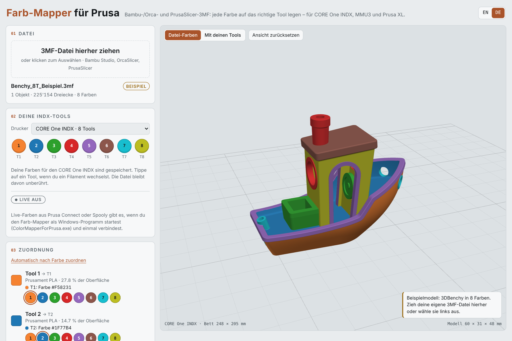
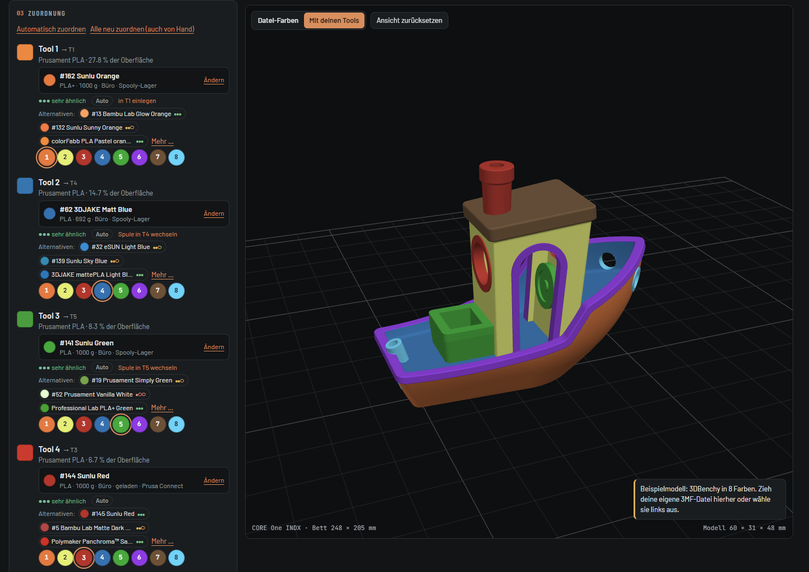
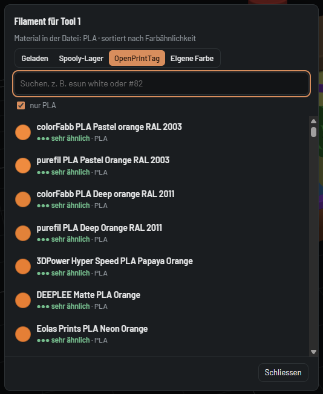
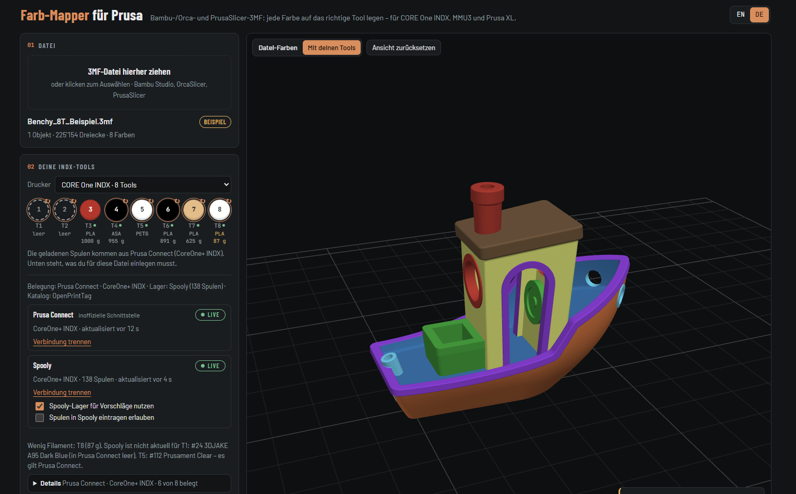
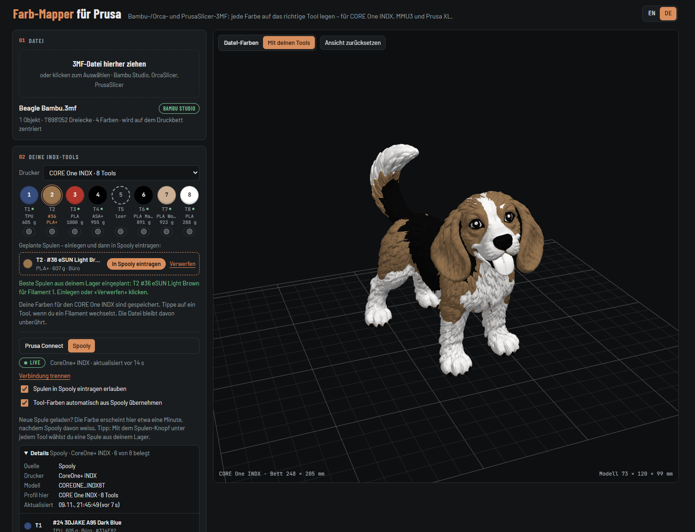
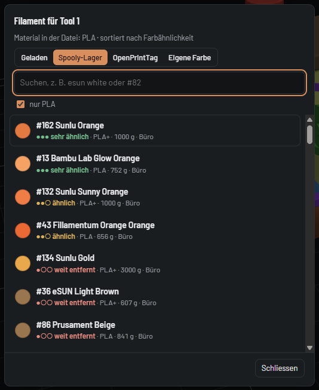

# Farb-Mapper für Prusa (Color Mapper for Prusa)

[English](README.md) · **Deutsch**

> **Unabhängiges Projekt.** Der Farb-Mapper für Prusa ist ein kostenloses Community-Tool von [DomiTech3D](https://github.com/DomiTech3D).
> Er ist **nicht mit Prusa Research verbunden** (auch nicht mit Bambu Lab oder Spooly) und wird von Prusa weder unterstützt noch empfohlen.

Jede Farbe einer mehrfarbigen 3MF auf das richtige Tool deines Prusa-Druckers legen – im Browser, ohne neu zu bemalen.

Du hast ein bemaltes Modell für Bambu Studio, OrcaSlicer oder PrusaSlicer gefunden, aber die Farben liegen auf anderen Extrudern als die Filamente in deinem Drucker. Der Farb-Mapper zeigt das Modell in 3D, du legst jede Farbe der Datei auf eines deiner Tools oder einen deiner MMU-Slots, und er speichert eine 3MF für PrusaSlicer mit entsprechend verschobener Bemalung.

<picture>
  <source media="(prefers-color-scheme: dark)" srcset="docs/screenshot-de-dark.png">
  
</picture>

## Funktionen

**Überall (Web-Version und Windows-Programm)**

- Öffnet 3MF-Projekte aus **Bambu Studio, OrcaSlicer und PrusaSlicer** (bemalte Modelle und Farben pro Objekt)
- 3D-Vorschau mit den Farben der Datei oder mit deinen Filamenten; mit der Maus über eine Farbe oder ein Tool fahren zeigt genau, welche Flächen es druckt
- **Eine Zeile pro Dateifarbe: Dateifarbe → Filament → Tool.** Jede Zeile zeigt das gewählte Filament (Farbe, Name, Marke, Quelle), wie gut es passt (sehr ähnlich / ähnlich / weit entfernt) und ob es automatisch oder von Hand gesetzt ist
- **Automatische Zuordnung nach empfundenem Farbabstand** (CIEDE2000) und Farbfamilie – Dunkelgrün geht auf ein Grün, nicht auf Schwarz; Braun auf Braun, nicht auf Rot
- **Eine Zeile ändern, nur diese Zeile ändert sich.** «Automatisch zuordnen» behält die von Hand gesetzten Zeilen, «Alle neu zuordnen» beginnt von vorn
- 2–3 **Alternativen** pro Zeile und eine Auswahl mit allem, was in Frage kommt: geladene Filamente, der **[OpenPrintTag](https://openprinttag.org)**-Katalog, eine eigene Farbe (Farbwähler oder Hex-Code) und im Windows-Programm dein Spooly-Lager. Suche nach Wörtern in beliebiger Reihenfolge – `esun white` findet «eSun ePLA Cold White»
- Mehr Farben als Tools: ähnliche Farben teilen sich ein Tool, und die Zeile sagt es
- **Ladeliste:** welche Spule vor dem Druck in welches Tool gehört – auf der Seite, zum Kopieren oder als Textdatei neben der 3MF gespeichert
- Deine Tool-Farben bleiben pro Drucker im Browser gespeichert
- Englisch und Deutsch, oben rechts umschaltbar
- Alles läuft lokal: deine 3MF-Dateien werden nirgends hochgeladen (heruntergeladen wird nur die öffentliche Filamentliste von OpenPrintTag)

**Windows-Programm (optional)**

- **Live aus Prusa Connect** (inoffiziell): was in jedem Tool oder MMU-Slot geladen ist
- **Live aus [Spooly](https://spooly.eu)** (offizielle Schnittstelle): Spulennummer, Restgewicht, Lagerort – und dein ganzes Lager für Vorschläge
- **Beide gleichzeitig** nutzen: Prusa Connect sagt, was geladen ist, Spooly ergänzt die Details. Ohne Connect liefert Spooly die Belegung. Ist Spooly für ein Tool nicht aktuell, sagt das Programm es
- Optional: die einzulegenden Spulen mit einem Klick in Spooly eintragen
- **Details** zeigt Drucker, Aktualisierungszeit und jedes Tool mit Spule, Material, Restgewicht und Lagerort
- Warnungen bei knappen Spulen und wenn ein Druck Materialien mischen würde (zum Beispiel PLA und ASA)

## Unterstützte Drucker

| Drucker | Tools |
|---|---|
| CORE One INDX, CORE One L INDX | 4 oder 8 Tools |
| CORE One, CORE One L, MK4S, MK3.9S, MK3.5S mit MMU3 | 5 Slots |
| Prusa XL, XL+ | 5 oder 2 Tools |

Getestet an einem echten CORE One INDX. Die anderen Drucker nutzen dasselbe Dateiformat und dieselben Daten aus Prusa Connect und Spooly, wurden aber noch nicht an echter Hardware ausprobiert – Rückmeldungen sind willkommen.

## Web-Version oder Windows-Programm?

Beide sind derselbe Farb-Mapper. Das Windows-Programm bringt zusätzlich die Live-Daten aus Prusa Connect und Spooly.

| | Web-Version | Windows-Programm |
|---|---|---|
| Installation | keine | `ColorMapperForPrusa.exe` herunterladen und starten |
| Läuft auf | jedem Computer oder Tablet mit aktuellem Browser (Windows, macOS, Linux) | Windows |
| 3MF öffnen, zuordnen, speichern, Ladeliste | ja | ja |
| OpenPrintTag-Katalog, eigene Farben | ja | ja |
| Was im Drucker geladen ist | einmal pro Drucker von Hand, der Browser merkt es sich | automatisch aus Prusa Connect und/oder Spooly |
| Spulen aus deinem Spooly-Lager | – | ja |

## Web-Version

- **Online:** [domitech3d.github.io/color-mapper-for-prusa](https://domitech3d.github.io/color-mapper-for-prusa/)
- **Offline:** `color-mapper.html` aus dem [neusten Release](../../releases/latest) herunterladen und in Chrome, Edge, Firefox oder Safari öffnen.

Die Seite startet auf Englisch – oben rechts auf **DE** klicken, der Browser merkt sich die Wahl.

1. Bei **Drucker** deinen Drucker wählen.
2. Die Farbe jedes Tools oder Slots einstellen: antippen und die Farbe des geladenen Filaments wählen. Das machst du einmal, der Browser merkt es sich.
3. Die 3MF-Datei auf die Seite ziehen. Jede Farbe der Datei bekommt automatisch ein Filament und ein Tool.
4. Die Zeilen unter **Zuordnung** prüfen (siehe [Die Zuordnung](#die-zuordnung)) und ändern, was du willst.
5. **Für PrusaSlicer speichern** klicken. Ist **Ladeliste als Textdatei mitspeichern** angehakt (Standard), gibt es zusätzlich `…_Ladeliste.txt`.

### Ergebnis in PrusaSlicer öffnen

1. Im PrusaSlicer deinen Drucker wählen (zum Beispiel den CORE One INDX).
2. Datei ins Fenster ziehen oder **Datei → Importieren → STL/3MF/STEP/OBJ/AMF** (Ctrl+I).
3. Fragt PrusaSlicer «Als Projekt öffnen oder nur Geometrie importieren?», **nur Geometrie** wählen, damit dein Drucker-Profil bleibt.
4. Vor dem Drucken die Bemalung mit dem Werkzeug **Multi-Material-Bemalung** (Taste N) kontrollieren.

## Die Zuordnung



Die Zuordnung funktioniert in der Web-Version und im Windows-Programm gleich. Nur das Spooly-Lager (und die Lagerorte und Restgewichte daraus) braucht das Windows-Programm mit Spooly – der Screenshot zeigt es mit Spooly.

Jede Farbe deiner Datei bekommt eine Zeile:

- **Dateifarbe** links, mit ihrem Anteil an der Oberfläche.
- **Filament** – der Knopf zeigt Farbe, Name, Marke, Restgewicht und woher es kommt (*geladen*, *OpenPrintTag*, *eigene Farbe* und im Windows-Programm *Spooly-Lager*). Ein Klick darauf öffnet die Auswahl.
- **Tool** – die runden Knöpfe darunter. Ein Klick druckt diese Farbe mit einem anderen Tool.
- **Qualität:** ●●● sehr ähnlich, ●●○ ähnlich, ●○○ weit entfernt – nach dem empfundenen Farbabstand.
- **Auto** oder **✎ von Hand**, und **wieder automatisch** für eine einzelne Zeile.
- **Hinweise**, zum Beispiel *in T6 einlegen*, *teilt T4 mit Tool 7*, *PETG statt PLA*.
- **Alternativen:** die nächstbesten Filamente – geladen (im Windows-Programm auch aus dem Spooly-Lager) und eines aus dem OpenPrintTag-Katalog.

**So entscheidet die Automatik**

- Zuerst die Farbe: der empfundene Abstand (CIEDE2000, Helligkeit halb gewichtet) plus ein Aufschlag für eine andere Farbfamilie – so bleibt Braun braun, und Grau landet nicht auf einem farbigen Tool.
- Material: Filamente im Material der Datei (PLA für PLA) werden bevorzugt, solange eines davon mindestens *ähnlich* ist.
- Mit Spooly (Windows-Programm) zählen auch die Spulen aus deinem Lager. Eine geladene Spule gewinnt gegen eine aus dem Lager, wenn sie praktisch gleich gut passt – damit du nicht unnötig wechselst. Fast leere Spulen kommen zuletzt.
- Lager-Spulen kommen zuerst in ein Tool mit praktisch gleicher Farbe (zum Beispiel schwarzes PLA in das Tool mit schwarzem ASA), dann in leere Slots, dann in das Tool, das der Druck nicht braucht und dessen bisherige Farbe am ähnlichsten ist. Tools, die der Druck braucht, werden nie ersetzt.
- Mehr Farben als Tools: Die Farbe teilt sich das ähnlichste Tool, und die Zeile sagt es.
- Der OpenPrintTag-Katalog erscheint nur als Alternative – er wird nie automatisch gewählt, weil diese Spulen weder im Drucker noch im Lager sind.

**Von Hand ändern**

- Ein Tool anklicken oder ein Filament wählen: **Nur diese Zeile ändert sich.** Ist das Filament noch nicht im Drucker, kommt es in ein freies Tool (gleiche Farbe, dann leer, dann am ähnlichsten).
- **Automatisch zuordnen** ordnet alle automatischen Zeilen neu zu und behält die von Hand gesetzten. **Alle neu zuordnen (auch von Hand)** beginnt von vorn.
- Die Auswahl hat vier Reiter: **Geladen**, **Spooly-Lager** (Windows-Programm mit Spooly), **OpenPrintTag** und **Eigene Farbe** (Farbwähler oder Hex-Code `#RRGGBB`). Die Suche findet Wörter in beliebiger Reihenfolge, Gross-/Kleinschreibung, Akzente und Bindestriche sind egal – `creality blue` findet «Creality PLA Blue», `#82` die Spule Nummer 82. **nur PLA** zeigt nur das Material der Datei.

**Ladeliste**

Unter den Zeilen steht bei **Vor dem Druck einlegen** jedes Tool, das eine andere Spule braucht, und was jetzt drin ist (mit Spooly auch der Lagerort). **Als Textdatei speichern** und **Kopieren** nehmen die ganze Liste mit; beim Speichern für PrusaSlicer wird sie ebenfalls gespeichert (`…_Ladeliste.txt`, unter **Speichern** abschaltbar). Die Textdatei nennt auch, was geladen bleibt, welche Tools nicht gebraucht werden, und Hinweise. Stellst du die Farben von Hand ein (Web-Version), übernimmt **Eingelegt** die neue Farbe für das Tool; im Windows-Programm mit Spooly gibt es stattdessen **In Spooly eintragen** (siehe Spooly). Dein Browser fragt eventuell einmal, ob die Seite mehrere Dateien herunterladen darf – zulassen.

## OpenPrintTag-Katalog

**In der Web-Version und im Windows-Programm.** [OpenPrintTag](https://openprinttag.org) ist eine offene Datenbank mit Filamenten und ihren Farben. Der Farb-Mapper zeigt daraus Filamente, die zu einer Dateifarbe passen und die du kaufen oder einlegen könntest – eines als Alternative unter jeder Zeile, alle im Reiter **OpenPrintTag** der Auswahl. Ein Konto oder eine Einrichtung braucht es nicht.

- Die Liste wird live geladen: Die Web-Version lädt sie von database.openprinttag.org und behält eine Kopie einen Tag im Browser; das Windows-Programm holt sie selbst und behält eine Kopie 6 Stunden. Ohne Internet gilt die letzte Kopie.
- Filamente aus dem Katalog werden nie automatisch gewählt – sie sind weder im Drucker noch im Lager. Wähle eines von Hand, dann sagt dir die Ladeliste, dass du es einlegen musst.
- Die Daten stehen unter der MIT-Lizenz.



## Windows-Programm

1. `ColorMapperForPrusa.exe` aus dem [neusten Release](../../releases/latest) herunterladen und starten. Ein schwarzes Fenster geht auf, der Farb-Mapper öffnet sich im Browser.
2. Im Kasten unter den Tools **Prusa Connect**, **Spooly** oder beide verbinden (siehe unten).
3. Das schwarze Fenster offen lassen, solange du den Farb-Mapper nutzt. Schliessen beendet das Programm.

**«Der Computer wurde durch Windows geschützt»:** Das Programm ist nicht signiert, deshalb warnt Windows SmartScreen beim ersten Start. **Weitere Informationen → Trotzdem ausführen** klicken. Blockiert dein Browser oder deine Firma das Herunterladen von `.exe`-Dateien, geht das Windows-Programm auf diesem Computer nicht – die Web-Version funktioniert auch ohne.

*Optional – Download prüfen:* Die Dateien in den Releases baut GitHub direkt aus diesem Quellcode. Vergleiche den SHA-256 (`Get-FileHash ColorMapperForPrusa.exe` in PowerShell) mit `SHA256SUMS.txt` aus dem Release, oder führe mit dem [GitHub CLI](https://cli.github.com/) `gh attestation verify ColorMapperForPrusa.exe --repo DomiTech3D/color-mapper-for-prusa` aus.

### Woher die Belegung kommt



Die Zeile **Belegung** unter den Tools zeigt, welche Quelle gilt:

| Verbunden | Was geladen ist, kommt aus |
|---|---|
| Prusa Connect und Spooly | Prusa Connect. Spooly ergänzt Spulennummer, Restgewicht und Lagerort, wenn seine Spule in diesem Slot die gleiche Farbe hat. Kennt Prusa Connect nur das Material, kommt die Farbe aus Spooly. Widersprechen sich die beiden, erscheint *Spooly ist nicht aktuell für T3* – es gilt Prusa Connect. |
| nur Spooly (oder Prusa Connect fällt aus) | Spooly |
| keines | die Farben, die du von Hand einstellst |

Die Tools zeigen, was geladen ist. Solange eine Live-Quelle gilt, wechselst du das Filament am Drucker oder in Spooly, nicht auf der Seite; ein ↻ markiert Tools, deren Spule für diese Datei gewechselt werden soll.

### Live-Farben aus Prusa Connect

1. **Mit Prusa Connect verbinden** klicken.
2. Auf der Prusa-Seite anmelden, die sich öffnet. Das Programm sieht dein Passwort nie.
3. Hast du mehrere Drucker, wähle deinen bei **Drucker**. Das passende Drucker-Profil wird automatisch gewählt.

Die Daten werden alle 30 Sekunden aktualisiert. Legst du eine neue Spule ein, ändert sich das Tool von selbst. Ein Tool ohne Filament in Prusa Connect erscheint als leer.

### Live-Farben und Lager aus Spooly

[Spooly](https://spooly.eu) ist eine Filament-Verwaltung. Über die offizielle Schnittstelle liest der Farb-Mapper, welche Spule in welchem Slot steckt und was du an Lager hast.



**Du brauchst**

- ein Spooly-Konto mit **Pro** (oder der Testphase) und **API-Zugang** (die Schnittstelle ist im Moment eine Beta – Zugang bei Spooly anfragen)
- deinen Drucker in Spooly mit seinen Slots eingerichtet (beim INDX: Slots 1-1 bis 1-8)
- das Windows-Programm – Spooly erlaubt keinen Zugriff aus Webseiten, deshalb geht das nicht in der Web-Version

**Einrichten**

1. In Spooly einen **persönlichen API-Schlüssel** erstellen (er beginnt mit `spk_`). Lesen genügt. Nur das optionale *Eintragen von Spulen in Spooly* (siehe unten) braucht einen Schlüssel, der schreiben darf.
2. `ColorMapperForPrusa.exe` starten, den Schlüssel bei **Spooly** einfügen und **Mit Spooly verbinden** klicken. Der Schlüssel wird sofort geprüft.
3. Hat Spooly mehrere Drucker, im Spooly-Kasten bei **Drucker** deinen wählen. Ist Prusa Connect verbunden, wird der Drucker mit dem gleichen Namen automatisch gewählt.
4. Unter **Details** kontrollieren, dass jedes Tool die richtige Spule zeigt.

**So funktioniert es**

- **Geladene Spulen:** kommen aus deinen Spooly-Slots (oder aus Prusa Connect, siehe oben) und werden etwa jede Minute aktualisiert. Das Drucker-Profil wird anhand des Druckermodells gewählt (zum Beispiel `COREONE_INDX8T`). Unter jedem Tool stehen Material und Restgewicht; knappe Spulen werden markiert.
- **Dein Lager:** Mit **Spooly-Lager für Vorschläge nutzen** (Standard) wählt die Automatik auch Spulen, die nicht geladen sind – nach den Regeln in [Die Zuordnung](#die-zuordnung). Ohne Haken nimmt sie nur geladene Spulen; das Lager bleibt im Reiter **Spooly-Lager** der Auswahl verfügbar – durchsuchbar, mit Restgewicht und Lagerort.

  
- **In Spooly ändert sich nichts von selbst.** Spulen aus dem Lager stehen mit Lagerort in der Ladeliste; sobald Spooly (oder Prusa Connect) sie im Tool meldet, gelten sie als geladen.

**Optional: Spulen in Spooly eintragen**

**Spulen in Spooly eintragen erlauben** anhaken (standardmässig aus). Dann bekommt jede Spule in der Ladeliste einen Knopf **In Spooly eintragen**. Ohne diesen Klick wird in Spooly nichts geändert.

- Das braucht in Spooly den **Slot-Autopiloten** und einen Schlüssel, der schreiben darf.
- Meldet der Drucker für den Slot eine andere Farbe, fragt der Farb-Mapper zuerst nach (**Trotzdem eintragen**).

**Gut zu wissen**

- **Jeden Slot einmal in Spooly zuweisen.** Spooly bietet einen Slot der Schnittstelle erst an, wenn ihm einmal in Spooly eine Spule zugewiesen wurde. Ein nie benutzter Slot fehlt – er lässt sich aus dem Farb-Mapper nicht eintragen, und im Programm-Protokoll steht *«fehlt in GET /slots»*. Abhilfe: dem Slot in Spooly einmal irgendeine Spule zuweisen (danach darfst du ihn wieder leeren).
- Der Schlüssel wird verschlüsselt (Windows DPAPI) in `%APPDATA%\ColorMapperForPrusa` gespeichert, nie mehr angezeigt und nie protokolliert. **Verbindung trennen** löscht ihn.
- Das Programm fragt Spooly nur, solange der Farb-Mapper offen ist: etwa zwei Abfragen pro Minute, das Lager alle fünf Minuten. Das Tageslimit von Spooly (10'000 Abfragen) ist weit weg.
- Der Farb-Mapper kann nicht beurteilen, ob eine Spule für den Druck *genug* Filament hat: Eine 3MF-Datei enthält keinen Verbrauch – den rechnet erst der Slicer.
- Spooly ist ein eigenständiges Produkt; dieses Projekt ist nicht mit Spooly verbunden.

**Wenn etwas nicht klappt**

| Meldung | Was tun |
|---|---|
| Spooly nimmt diesen Schlüssel nicht an | Schlüssel nochmals vollständig kopieren (beginnt mit `spk_`); sonst in Spooly einen neuen erstellen. |
| Spooly verweigert den Zugriff | Dein Spooly-Konto braucht Pro (oder die Testphase) und API-Zugang. |
| Spooly liefert T2 noch nicht in seiner Slot-Liste | Dem Slot in Spooly einmal eine Spule zuweisen (siehe *Gut zu wissen*). |
| Spooly führt T2 ohne Slot-ID | In Spooly den Slot-Autopiloten für diesen Drucker einschalten. |
| Spooly erlaubt diesem Schlüssel keine Änderungen an Slots | Einen Schlüssel mit Schreibrecht erstellen, oder das Eintragen ausgeschaltet lassen. |
| Das Tageslimit von Spooly ist aufgebraucht | Am nächsten Tag werden die Farben wieder aktualisiert. |
| Spooly ist nicht aktuell für T3 | Prusa Connect meldet in diesem Tool eine andere Spule. Den Slot in Spooly nachführen – oder ignorieren, es gilt Prusa Connect. |

Das **Protokoll des Programms** unten im Kasten zeigt, welche Slots Spooly für jeden Drucker anbietet.

### Was das Windows-Programm tut und speichert

- Es ist nur auf `127.0.0.1:8765` erreichbar (dein eigener Computer) und lehnt Anfragen von anderen Websites ab.
- Prusa Connect: Du meldest dich auf der Prusa-Seite an; die Anmeldung wird verschlüsselt (Windows DPAPI) in `%APPDATA%\ColorMapperForPrusa` gespeichert. Es liest nur deine Drucker und das Filament in jedem Tool.
- Spooly: Der API-Schlüssel wird gleich gespeichert. Das Programm liest Drucker, Slots und Spulen; in Spooly schreibt es nur, wenn du **In Spooly eintragen** klickst.
- OpenPrintTag: Die öffentliche Filamentliste wird heruntergeladen und im selben Ordner zwischengespeichert (`openprinttag.json`).
- **Verbindung trennen** löscht die gespeicherte Anmeldung bzw. den Schlüssel. Zugangsschlüssel landen nie im Protokoll.

## Zur Verbindung mit Prusa Connect (inoffiziell)

- Prusa bietet für fremde Programme keine öffentliche Schnittstelle an. Das Windows-Programm nutzt dieselbe, **nicht dokumentierte** Schnittstelle, die auch die Prusa-Connect-Webseite selbst verwendet.
- Prusa kann diese Schnittstelle jederzeit ändern. **Die Live-Farben aus Prusa Connect können deshalb in Zukunft ohne Vorwarnung nicht mehr funktionieren.** Sie werden ohne Gewähr angeboten.
- **Die Web-Version hängt nicht von Prusa Connect ab und wird weiterhin unterstützt** – ohne automatische Filament-Synchronisierung: Die Tool-Farben stellst du von Hand ein (einmal pro Drucker, der Browser merkt sie sich).
- Die Verbindung zu Spooly nutzt die offizielle Schnittstelle von Spooly und ist davon nicht betroffen.

## Häufige Fragen

**Funktioniert das auch für Bambu-Lab-Drucker?**
Dateien aus Bambu Studio und OrcaSlicer lassen sich *öffnen*, das Ergebnis ist aber immer ein PrusaSlicer-Projekt für einen Prusa-Drucker.

**Geht das auch auf dem Mac?**
Ja, die Web-Version funktioniert in Safari, Chrome und Firefox. Das Windows-Programm mit Live-Farben gibt es nur für Windows.

**Wird meine Originaldatei verändert?**
Nein. Es wird immer eine neue Datei gespeichert (`…_INDX.3mf`, `…_MMU3.3mf`, `…_XL.3mf` oder `…_umgemappt.3mf`).

**Prüft er, ob eine Spule genug Filament hat?**
Nein. Eine 3MF-Datei enthält keinen Filamentverbrauch; den rechnet erst der Slicer (er hängt von Infill, Wänden, Stützen und Spülturm ab). Der Farb-Mapper zeigt das Restgewicht aus Spooly, damit du es selbst einschätzen kannst.

**Warum wird beim Darüberfahren manches grau?**
Absichtlich: Nur die Flächen der Farbe oder des Tools unter dem Mauszeiger bleiben farbig.

**Warum steht in einer Zeile «teilt T4 mit …»?**
Die Datei hat mehr Farben als du Tools hast (oder als Tools frei sind). Die Farbe druckt dann mit dem ähnlichsten Tool. Wähle für diese Zeile ein anderes Tool oder Filament, wenn dir das lieber ist.

**Lässt sich die Ladeliste in die 3MF schreiben?**
PrusaSlicer würde sie nicht anzeigen: Mit *nur Geometrie* übernimmt er nur Geometrie und Bemalung. Deshalb ist sie eine eigene Textdatei.

## Rückmeldungen

Das ist ein Hobbyprojekt und mein erstes auf GitHub – Rückmeldungen sind sehr willkommen. Einen Fehler gefunden, eine 3MF, die nicht klappt, oder eine Idee? Bitte [ein Issue eröffnen](../../issues). Bei Problemen mit einer bestimmten Datei hilft eine kurze Beschreibung: welcher Drucker, aus welchem Slicer die Datei stammt und was schiefging.

## Selbst bauen

Benötigt: Python 3, Go 1.22 oder neuer, Node.js (nur für die Tests).

```sh
python3 app/build.py                      # → dist/color-mapper.html und desktop/web/color-mapper.html
node app/test/roundtrip.js demo/benchy_8t.3mf
node app/test/match.test.js               # Farbabgleich und Tool-Verteilung

cd desktop
go test ./...
GOOS=windows GOARCH=amd64 go build -ldflags "-s -w" -o ColorMapperForPrusa.exe .
```

Die Seite steht in `app/index.src.html`, die 3MF-Verarbeitung in `app/core.js` und der Farbabgleich in `app/match.js` (ohne Abhängigkeiten). Das Windows-Programm (`desktop/`) nutzt nur die Go-Standardbibliothek.

## Lizenz

Copyright © 2026 [DomiTech3D](https://github.com/DomiTech3D). Lizenziert unter der **GNU General Public License v3.0** ([LICENSE](LICENSE)) mit zusätzlichen Bedingungen zur Namensnennung ([NOTICE.md](NOTICE.md)).

In einfachen Worten (massgebend sind die Lizenztexte):

- Du darfst den Farb-Mapper kostenlos nutzen, weitergeben und verändern.
- Wer ihn weitergibt oder eine veränderte Version veröffentlicht, muss deren Quellcode unter derselben Lizenz offenlegen.
- Der Hinweis **«Color Mapper for Prusa by DomiTech3D»** (bzw. «Farb-Mapper für Prusa von DomiTech3D») mit Link zu diesem Projekt muss erhalten bleiben – sichtbar in der Oberfläche (Fusszeile der Seite) und in der Dokumentation.
- Veränderte Versionen müssen als verändert gekennzeichnet sein (zum Beispiel «Based on Color Mapper for Prusa by DomiTech3D») und dürfen nicht als Original ausgegeben werden.

## Hinweise

- Prusa, Prusa Connect, PrusaSlicer, CORE One, INDX und MMU3 sind Marken von Prusa Research a.s.; Spooly ist ein Produkt seines Entwicklers; andere Produktnamen gehören ihren Inhabern.
- Das Ergebnis vor dem Drucken immer in PrusaSlicer kontrollieren.
- Das Beispielmodell ist der 3DBenchy, den NTI 2025 als gemeinfrei freigegeben hat.
- Filamentfarben im Katalog: [OpenPrintTag Database](https://github.com/OpenPrintTag/openprinttag-database) (MIT-Lizenz), live von database.openprinttag.org geladen. Der Katalog wird nur als Alternative angeboten und nie automatisch gewählt.
