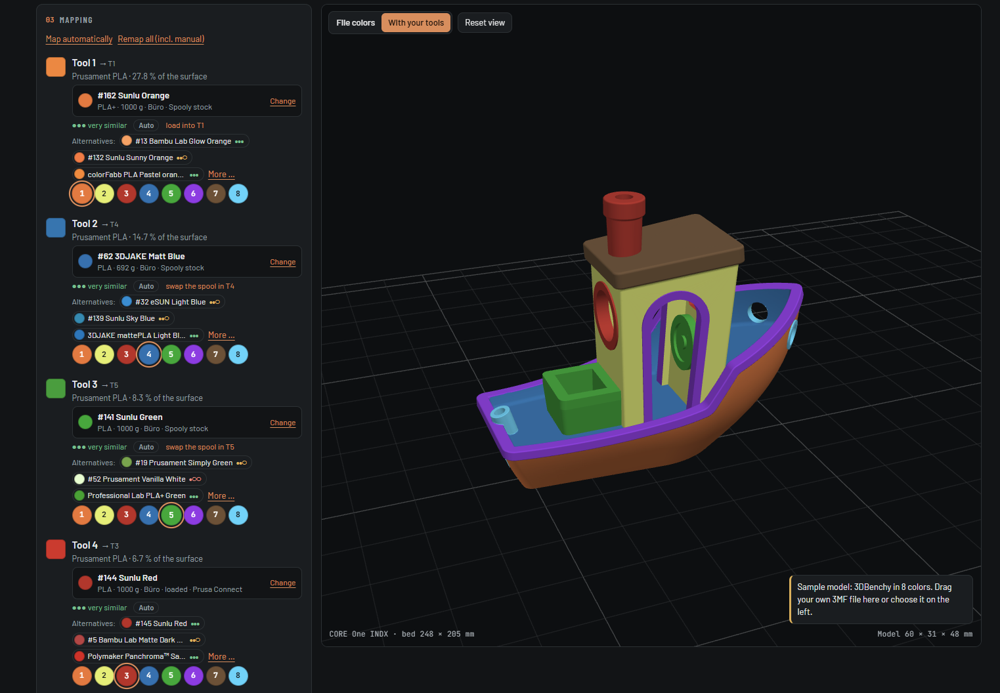
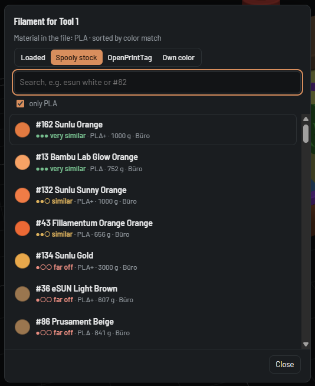
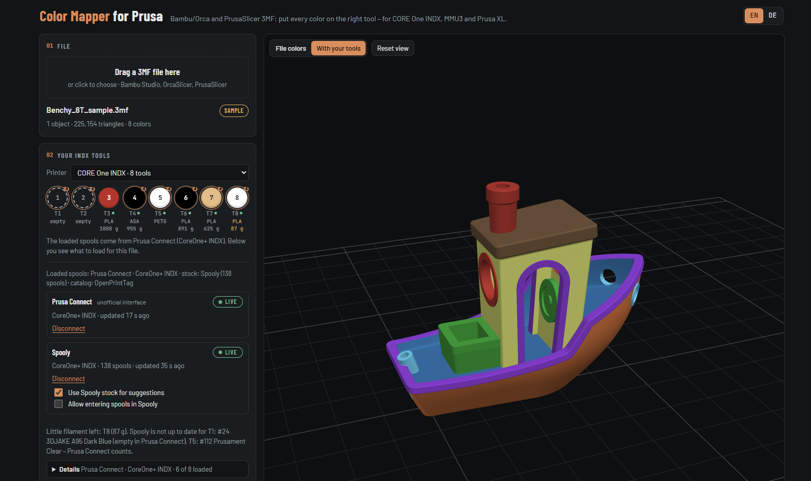
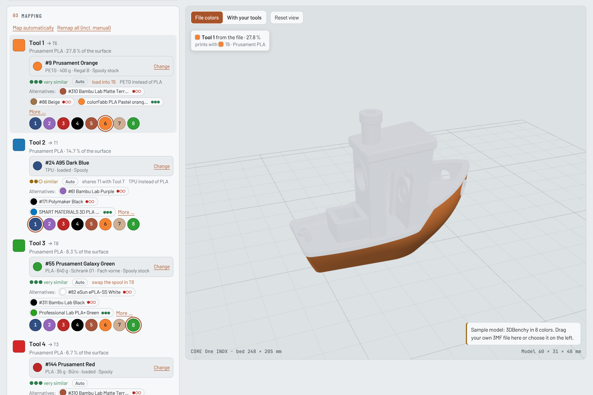
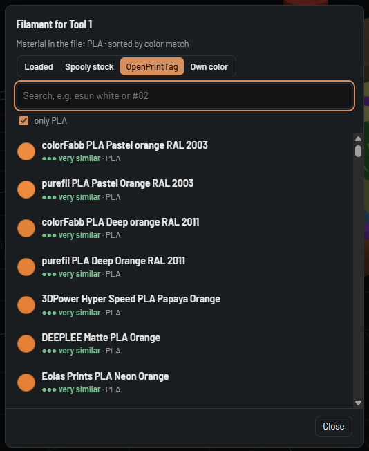

# Color Mapper for Prusa

**English** · [Deutsch](README.de.md)

> **Independent project.** Color Mapper for Prusa is a free community tool by [DomiTech3D](https://github.com/DomiTech3D).
> It is **not affiliated with, endorsed by or supported by Prusa Research** (or Bambu Lab or Spooly).

Put every color of a multi-color 3MF on the right tool of your Prusa printer – in the browser, without repainting anything.

You found a painted model for Bambu Studio, OrcaSlicer or PrusaSlicer, but its colors sit on different extruders than the filaments loaded in your printer. Color Mapper for Prusa shows the model in 3D, lets you assign each file color to one of your tools or MMU slots, and saves a 3MF for PrusaSlicer with the painting moved accordingly.

<picture>
  <source media="(prefers-color-scheme: dark)" srcset="docs/screenshot-dark.png">
  
</picture>

## Features

**Everywhere (web version and Windows program)**

- Opens 3MF projects from **Bambu Studio, OrcaSlicer and PrusaSlicer** (painted models and per-object colors)
- 3D preview with the file colors or with your filaments; hover a color or a tool to see exactly which areas it prints
- **One row per file color: file color → filament → tool.** Each row shows the chosen filament (color, name, brand, source), how close it is (very similar / similar / far off) and whether it was set automatically or by hand
- **Automatic mapping by perceived color difference** (CIEDE2000) and color family – a dark green goes to a green, not to black; a brown to brown, not to red
- **Change one row, only that row changes.** “Map automatically” keeps the rows you set by hand, “Remap all” starts over
- 2–3 **alternatives** per row, and a picker with everything you can choose from: loaded filaments, your Spooly stock, the **[OpenPrintTag](https://openprinttag.org)** catalog or your own color (color picker or hex code). Search by words in any order – `esun white` finds “eSun ePLA Cold White”
- More colors than tools: similar colors share a tool, and the row says so
- **Load list:** which spool goes into which tool before printing – on the page, to copy, or saved as a text file next to the 3MF
- Your tool colors are remembered per printer in your browser
- English and German, switchable at the top right
- Everything runs locally: your 3MF files are never uploaded anywhere (only the public OpenPrintTag color list is downloaded, at most once a day)

**Windows program (optional)**

- **Live from Prusa Connect** (unofficial): what is loaded in each tool or MMU slot
- **Live from [Spooly](https://spooly.eu)** (official API): spool number, remaining weight, storage location – and your whole stock for suggestions
- Use **both at once**: Prusa Connect says what is loaded, Spooly adds the details. Without Connect, Spooly provides the loaded spools. If Spooly is out of date for a tool, the program says so
- Optional: enter the spools to load in Spooly with one click
- **Details** lists printer, update time and every tool with spool, material, remaining weight and storage location
- Warnings for spools that are running low and for prints that mix materials (for example PLA and ASA)

## Supported printers

| Printer | Tools |
|---|---|
| CORE One INDX, CORE One L INDX | 4 or 8 tools |
| CORE One, CORE One L, MK4S, MK3.9S, MK3.5S with MMU3 | 5 slots |
| Prusa XL, XL+ | 5 or 2 tools |

Tested on a real CORE One INDX. The other printers use the same file format and the same data from Prusa Connect and Spooly, but haven't been tried on real hardware yet – feedback is welcome.

## Web version or Windows program?

Both are the same Color Mapper. The Windows program adds the live data from Prusa Connect and Spooly.

| | Web version | Windows program |
|---|---|---|
| Installation | none | download `ColorMapperForPrusa.exe` and start it |
| Works on | any computer or tablet with a current browser (Windows, macOS, Linux) | Windows |
| Open, map and save 3MF, load list | yes | yes |
| OpenPrintTag catalog, own colors | yes | yes |
| What is loaded in your printer | set by hand once per printer, remembered by your browser | automatically from Prusa Connect and/or Spooly |
| Spools from your Spooly stock | – | yes |

## Web version

- **Online:** [domitech3d.github.io/color-mapper-for-prusa](https://domitech3d.github.io/color-mapper-for-prusa/)
- **Offline:** download `color-mapper.html` from the [latest release](../../releases/latest) and open it in Chrome, Edge, Firefox or Safari.

1. Choose your printer under **Printer**.
2. Set the color of each tool or slot: tap it and pick the color of the filament that is loaded. You do this once; the browser remembers it.
3. Drag your 3MF file onto the page. Every file color gets a filament and a tool automatically.
4. Check the rows under **Mapping** (see [The mapping](#the-mapping)) and change what you want.
5. Click **Save for PrusaSlicer**. With **Also save the load list as a text file** ticked (default), you also get `…_load-list.txt`.

### Opening the result in PrusaSlicer

1. Select your printer in PrusaSlicer (for example the CORE One INDX).
2. Drag the file into the window or use **File → Import → Import STL/3MF/STEP/OBJ/AMF** (Ctrl+I).
3. If PrusaSlicer asks whether to open the file as a project or import the geometry only, choose **Import geometry only** so your printer profile stays.
4. Check the painting with the **Multimaterial painting** tool (key N) before printing.

## The mapping



Every color of your file gets one row:

- **File color** on the left, with its share of the surface.
- **Filament** – the button shows color, name, brand, remaining weight and where it comes from (*loaded*, *Spooly stock*, *OpenPrintTag*, *own color*). Click it to choose another one.
- **Tool** – the round buttons below. Click one to print this color with another tool.
- **Quality:** ●●● very similar, ●●○ similar, ●○○ far off – based on the perceived color difference.
- **Auto** or **✎ manual**, and **back to auto** for a single row.
- **Notes**, for example *load into T6*, *shares T4 with Tool 7*, *PETG instead of PLA*.
- **Alternatives:** the next best filaments – loaded, from your stock, and one from the OpenPrintTag catalog.

**How the automatic mapping decides**

- Color first: the perceived difference (CIEDE2000, lightness counts half) plus a penalty for a different color family, so brown stays brown and grey doesn't land on a colored tool.
- Material: filaments in the file's material (PLA for PLA) are preferred, as long as one of them is at least *similar*.
- A loaded spool wins over one from your stock if it matches practically as well – you don't swap spools for nothing. Almost empty spools come last.
- Spools from your stock go first into a tool with practically the same color (for example black PLA into the tool with black ASA), then into empty slots, then into the tool the print doesn't need whose current color is most similar. Tools the print needs are never replaced.
- More colors than tools: the color shares the most similar tool, and the row says so.
- The OpenPrintTag catalog is only shown as an alternative – it is never chosen automatically, because those spools are not in your printer or stock.

**Changing things by hand**

- Click a tool or choose a filament: **only this row changes**. If the filament is not in the printer yet, it goes to a free tool (same color, then empty, then most similar).
- **Map automatically** maps all automatic rows again and keeps your manual rows. **Remap all (incl. manual)** starts over.
- The picker has four tabs: **Loaded**, **Spooly stock** (Windows program with Spooly), **OpenPrintTag** and **Own color** (color picker or hex code `#RRGGBB`). The search matches words in any order and ignores case, accents and hyphens – `creality blue` finds “Creality PLA Blue”, `#82` finds spool number 82. **only PLA** limits the list to the file's material.



**Load list**

Below the rows, **Load before printing** lists every tool that needs a different spool, with storage location and what is in it now. **Save as text file** and **Copy** take the whole list with you; when you save for PrusaSlicer, the list is saved too (`…_load-list.txt`, can be switched off under **Save**). The text file also lists what stays loaded, unused tools and notes. Your browser may ask once whether the page may download several files – allow it.

## Windows program

1. Download `ColorMapperForPrusa.exe` from the [latest release](../../releases/latest) and start it. A black window opens and the Color Mapper opens in your browser.
2. Connect **Prusa Connect**, **Spooly** or both in the box below the tools (see below).
3. Keep the black window open while you use the Color Mapper. Closing it stops the program.

**“Windows protected your PC”:** the program is not code-signed, so Windows SmartScreen warns about it on first start. Click **More info → Run anyway**. If your browser or company blocks downloading `.exe` files, you can't use the Windows program on that computer – the web version works without it.

*Optional – check the download:* the files in the releases are built by GitHub directly from this source code. Compare the SHA-256 (`Get-FileHash ColorMapperForPrusa.exe` in PowerShell) with `SHA256SUMS.txt` from the release, or, with the [GitHub CLI](https://cli.github.com/), run `gh attestation verify ColorMapperForPrusa.exe --repo DomiTech3D/color-mapper-for-prusa`.

### Where “loaded” comes from



The line **Loaded spools** below the tools shows which source is used:

| Connected | What is loaded comes from |
|---|---|
| Prusa Connect and Spooly | Prusa Connect. Spooly adds spool number, remaining weight and storage location when its spool in that slot has the same color. If Prusa Connect knows only the material, the color comes from Spooly. If the two disagree, a note says *Spooly is not up to date for T3* – Prusa Connect counts. |
| only Spooly (or Prusa Connect fails) | Spooly |
| neither | the colors you set by hand |

The tools show what is loaded. While a live source is used, you change the filament on the printer or in Spooly, not on the page; a ↻ marks tools whose spool should be swapped for this file.

### Live colors from Prusa Connect

1. Click **Connect to Prusa Connect**.
2. Sign in on the Prusa page that opens. The program never sees your password.
3. If you have several printers, choose yours under **Printer**. The matching printer profile is chosen automatically.

The data updates every 30 seconds. When you load a new spool, the tool changes by itself. A tool without filament in Prusa Connect is shown as empty.

### Live colors and stock from Spooly

[Spooly](https://spooly.eu) is a filament manager. Through its official API the Color Mapper reads which spool is in which slot and what you have in stock.



**You need**

- a Spooly account with **Pro** (or the trial) and **API access** (the API is currently a beta – request access from Spooly)
- your printer set up in Spooly with its slots (for an INDX: slots 1-1 to 1-8)
- the Windows program – Spooly does not allow access from web pages, so this does not work in the web version

**Set up**

1. In Spooly, create a **personal API key** (it starts with `spk_`). Reading is enough. Only the optional *entering of spools in Spooly* (see below) needs a key that may write.
2. Start `ColorMapperForPrusa.exe`, paste the key under **Spooly** and click **Connect to Spooly**. The key is checked right away.
3. If Spooly has several printers, choose yours under **Printer** in the Spooly box. With Prusa Connect connected, the printer with the same name is chosen automatically.
4. Check under **Details** that every tool shows the right spool.

**How it works**

- **Loaded spools:** come from your Spooly slots (or from Prusa Connect, see above), updated about every minute. The printer profile is chosen from the printer model (for example `COREONE_INDX8T`). Under each tool you see material and remaining weight; spools that are running low are marked.
- **Your stock:** with **Use Spooly stock for suggestions** ticked (default), the automatic mapping also picks spools that are not loaded, by the rules in [The mapping](#the-mapping). Without it, only loaded spools are used; the stock stays available in the picker.
- **Nothing changes in Spooly by itself.** Spools from your stock appear in the load list with their storage location; once Spooly (or Prusa Connect) reports them in the tool, they count as loaded.

**Optional: enter spools in Spooly**

Tick **Allow entering spools in Spooly** (off by default). Then each spool in the load list gets an **Enter in Spooly** button. Nothing is changed in Spooly without this click.

- This needs the **slot autopilot** in Spooly and a key that may write.
- If the printer reports a different color for the slot, the Color Mapper asks first (**Assign anyway**).

**Good to know**

- **Assign every slot once in Spooly.** Spooly only offers a slot to the API after a spool was assigned to it once in Spooly. A slot that was never used is missing – it can't be entered from the Color Mapper, and the program log shows *“not listed in GET /slots”*. Fix: assign any spool to that slot once in Spooly (you can empty it again afterwards).
- The key is stored encrypted (Windows DPAPI) in `%APPDATA%\ColorMapperForPrusa`, is never shown again and never written to the log. **Disconnect** deletes it.
- The program only calls Spooly while the Color Mapper is open: about two calls a minute, the stock every five minutes. Spooly's daily limit (10,000 calls) is far away.
- The Color Mapper can't tell whether a spool has *enough* filament for the print: a 3MF file contains no filament usage – that is calculated by the slicer.
- Spooly is an independent product; this project is not affiliated with it.

**If something doesn't work**

| Message | What to do |
|---|---|
| Spooly does not accept this key | Copy the key again completely (starts with `spk_`); create a new one in Spooly if needed. |
| Spooly refused access | Your Spooly account needs Pro (or the trial) and API access. |
| Spooly does not list T2 in its slot list | Assign a spool to that slot once in Spooly (see *Good to know*). |
| Spooly's daily limit is used up | Colors update again the next day. |
| Spooly lists T2 but without a slot ID | Turn on the slot autopilot for this printer in Spooly. |
| Spooly does not allow this key to change slots | Create a key with write access, or leave entering off. |
| Spooly is not up to date for T3 | Prusa Connect reports a different spool in that tool. Update the slot in Spooly – or ignore it, Prusa Connect counts. |

The **Program log** at the bottom of the box shows which slots Spooly offers for each printer.

### OpenPrintTag catalog

[OpenPrintTag](https://openprinttag.org) is an open database of filaments with their colors. The Color Mapper uses it to show spools you could buy or use that match a file color – as alternatives and in the **OpenPrintTag** tab of the picker. The list is loaded live (the Windows program fetches it itself and keeps a copy for 6 hours; the web version loads it from database.openprinttag.org and keeps a copy for a day). Without internet, the last copy is used. The data is published under the MIT license.



### What the Windows program does and stores

- It listens only on `127.0.0.1:8765` (your own computer) and refuses requests from other sites.
- Prusa Connect: you sign in on Prusa's own page; the sign-in is stored encrypted (Windows DPAPI) in `%APPDATA%\ColorMapperForPrusa`. It only reads your printers and the filament in each tool.
- Spooly: the API key is stored the same way. The program reads printers, slots and spools; it only writes to Spooly when you click **Enter in Spooly**.
- OpenPrintTag: the public filament list is downloaded and cached in the same folder (`openprinttag.json`).
- **Disconnect** deletes the stored sign-in or key. Tokens and keys are never written to the log.

## About the Prusa Connect connection (unofficial)

- Prusa does not offer a public interface for third-party tools. The Windows program uses the same, **undocumented** interface that the Prusa Connect website itself uses.
- Prusa can change that interface at any time. **The live colors from Prusa Connect may therefore stop working in the future**, without notice. They are provided as is.
- **The web version does not depend on Prusa Connect and will continue to be supported** – without automatic filament sync: you set the tool colors by hand (once per printer, the browser remembers them).
- The Spooly connection uses Spooly's official API and is not affected by this.

## FAQ

**Does it work for Bambu Lab printers?**
Bambu Studio and OrcaSlicer files can be *opened*, but the result is always a PrusaSlicer project for a Prusa printer.

**Does it work on a Mac?**
Yes, the web version works in Safari, Chrome and Firefox. The Windows program with live colors is only available for Windows.

**Does it change my original file?**
No. It always saves a new file (`…_INDX.3mf`, `…_MMU3.3mf`, `…_XL.3mf` or `…_remapped.3mf`).

**Does it check whether a spool has enough filament?**
No. A 3MF file contains no filament usage; only the slicer calculates it (it depends on infill, walls, supports and the wipe tower). The Color Mapper shows the remaining weight from Spooly so you can judge it yourself.

**Why do some areas turn grey while hovering?**
On purpose: only the areas printed by the color or tool under the mouse pointer stay in color.

**Why does a row say “shares T4 with …”?**
The file has more colors than you have tools (or than tools that are free). The color then prints with the most similar tool. Choose another tool or filament for that row if you prefer.

**Why is a catalog filament never chosen automatically?**
Spools from the OpenPrintTag catalog are not in your printer or your stock. They are suggestions; choose one by hand if you want to buy or load it, and load it as the load list says.

**Can the load list be put into the 3MF?**
PrusaSlicer would not show it: with *Import geometry only* it drops everything except the geometry and the painting. That's why it is a separate text file.

## Feedback

This is a hobby project and my first one on GitHub – feedback is very welcome. Found a bug, a 3MF that doesn't work, or have an idea? Please [open an issue](../../issues). For problems with a specific file, a short description of the printer, the slicer it came from and what went wrong helps a lot.

## Build from source

Requirements: Python 3, Go 1.22 or newer, Node.js (only for the test).

```sh
python3 app/build.py                      # → dist/color-mapper.html and desktop/web/color-mapper.html
node app/test/roundtrip.js demo/benchy_8t.3mf
node app/test/match.test.js               # color matching and tool allocation

cd desktop
go test ./...
GOOS=windows GOARCH=amd64 go build -ldflags "-s -w" -o ColorMapperForPrusa.exe .
```

The page source is `app/index.src.html`, the 3MF engine is `app/core.js` and the color matching is `app/match.js` (no dependencies). The Windows program (`desktop/`) only uses the Go standard library.

## License

Copyright © 2026 [DomiTech3D](https://github.com/DomiTech3D). Licensed under the **GNU General Public License v3.0** ([LICENSE](LICENSE)) with additional attribution terms ([NOTICE.md](NOTICE.md)).

In plain words (the license texts are what counts):

- You may use the Color Mapper for free, share it and change it.
- If you pass it on or publish a changed version, you must publish its source code under the same license.
- You must keep the credit **“Color Mapper for Prusa by DomiTech3D”** with a link to this project – visible in the user interface (page footer) and in the documentation.
- Changed versions must be marked as changed (for example “Based on Color Mapper for Prusa by DomiTech3D”) and must not be presented as the original.

## Notes

- Prusa, Prusa Connect, PrusaSlicer, CORE One, INDX and MMU3 are trademarks of Prusa Research a.s.; Spooly is a product of its developer; other product names belong to their owners.
- Always check the result in PrusaSlicer before printing.
- The sample model is the 3DBenchy, which NTI released into the public domain in 2025.
- Filament colors in the catalog: [OpenPrintTag Database](https://github.com/OpenPrintTag/openprinttag-database) (MIT license), loaded live from database.openprinttag.org. The catalog is only offered as an alternative and never chosen automatically.
