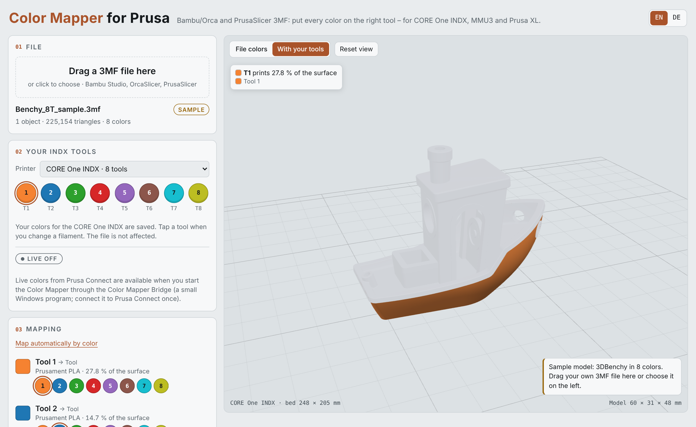

# Color Mapper for Prusa

**English** · [Deutsch](README.de.md)

> **Independent project.** Color Mapper for Prusa is a free community tool by [DomiTech3D](https://github.com/DomiTech3D).
> It is **not affiliated with, endorsed by or supported by Prusa Research** (or Bambu Lab).

Put every color of a multi-color 3MF on the right tool of your Prusa printer – in the browser, without repainting anything.

You found a painted model for Bambu Studio, OrcaSlicer or PrusaSlicer, but its colors sit on different extruders than the filaments loaded in your printer. Color Mapper for Prusa shows the model in 3D, lets you assign each file color to one of your tools or MMU slots, and saves a 3MF for PrusaSlicer with the painting moved accordingly.



## Features

- Opens 3MF projects from **Bambu Studio, OrcaSlicer and PrusaSlicer** (painted models and per-object colors)
- 3D preview with the file colors or with your loaded filaments; hover a color or a tool to see exactly which areas it prints
- Automatic mapping by color similarity, adjustable with one click per color
- Your tool colors are remembered per printer in your browser
- English and German, switchable at the top right
- Everything runs locally: your 3MF files are never uploaded anywhere
- Optional on Windows: **live tool colors from Prusa Connect** (unofficial, see below)

## Supported printers

| Printer | Tools |
|---|---|
| CORE One INDX, CORE One L INDX | 4 or 8 tools |
| CORE One, CORE One L, MK4S, MK3.9S, MK3.5S with MMU3 | 5 slots |
| Prusa XL, XL+ | 5 or 2 tools |

## How to use it

There are two ways. Both are the same Color Mapper; the Windows program only adds the live colors from Prusa Connect.

| | Web version | Windows program |
|---|---|---|
| Installation | none | download `ColorMapperForPrusa.exe` and start it |
| Works on | any computer or tablet with a current browser (Windows, macOS, Linux) | Windows |
| Open, map and save 3MF | yes | yes |
| Tool colors | set by hand once per printer, remembered by your browser | automatically from Prusa Connect, every 30 seconds |

### Web version (recommended to start)

- **Online:** `https://DomiTech3D.github.io/color-mapper-for-prusa/`
- **Offline:** download `color-mapper.html` from the [latest release](../../releases/latest) and open it in Chrome, Edge, Firefox or Safari.

1. Choose your printer under **Printer**.
2. Set the color of each tool or slot: tap it and pick the color of the filament that is loaded. You do this once; the browser remembers it.
3. Drag your 3MF file onto the page.
4. Check the mapping – every file color gets a tool. **Map automatically by color** does it for you; hover a row to see where the color is used.
5. Click **Save for PrusaSlicer**.

### Opening the result in PrusaSlicer

1. Select your printer in PrusaSlicer (for example the CORE One INDX).
2. Drag the file into the window or use **File → Import → Import STL/3MF/STEP/OBJ/AMF** (Ctrl+I).
3. If PrusaSlicer asks whether to open the file as a project or import the geometry only, choose **Import geometry only** so your printer profile stays.
4. Check the painting with the **Multimaterial painting** tool (key N) before printing.

### Windows program with live colors from Prusa Connect (optional)

`ColorMapperForPrusa.exe` runs the Color Mapper on your own computer and reads the filament loaded in each tool or MMU slot from Prusa Connect every 30 seconds. When you load a new spool, the color updates by itself.

1. Download `ColorMapperForPrusa.exe` from the [latest release](../../releases/latest) and start it. A black window opens and the Color Mapper opens in your browser.
2. Click **Connect to Prusa Connect** and sign in on the Prusa page that opens.
3. Keep the black window open while you use the Color Mapper. Closing it stops the program.

**“Windows protected your PC”:** the program is not code-signed, so Windows SmartScreen warns about it on first start. Click **More info → Run anyway**. You can check that the file was built by GitHub from this source code:

```
gh attestation verify ColorMapperForPrusa.exe --repo DomiTech3D/color-mapper-for-prusa
```

or compare its SHA-256 (`Get-FileHash ColorMapperForPrusa.exe` in PowerShell) with `SHA256SUMS.txt` from the release.

**What the Windows program does and stores**

- It listens only on `127.0.0.1:8765` (your own computer) and refuses requests from other sites.
- You sign in on Prusa's own sign-in page; the program never sees your password.
- The sign-in is stored in `%APPDATA%\ColorMapperForPrusa`, encrypted by Windows (DPAPI) so only your Windows user can read it. **Disconnect** deletes it.
- It only reads your printers and the filament loaded in each tool. Sign-in tokens are never written to the log.

## About the Prusa Connect connection (unofficial)

- Prusa does not offer a public interface for third-party tools. The Windows program uses the same, **undocumented** interface that the Prusa Connect website itself uses.
- Prusa can change that interface at any time. **The live colors may therefore stop working in the future**, without notice. They are provided as is.
- **The web version does not depend on Prusa Connect and will continue to be supported** – without automatic filament sync: you set the tool colors by hand (once per printer, the browser remembers them). The Windows program keeps working the same way if the connection ever fails.

## FAQ

**Does it work for Bambu Lab printers?**
Bambu Studio and OrcaSlicer files can be *opened*, but the result is always a PrusaSlicer project for a Prusa printer.

**Does it work on a Mac?**
Yes, the web version works in Safari, Chrome and Firefox. The Windows program with live colors is only available for Windows.

**Does it change my original file?**
No. It always saves a new file (`…_INDX.3mf`, `…_MMU3.3mf`, `…_XL.3mf` or `…_remapped.3mf`).

**Why do some areas turn grey while hovering?**
On purpose: only the areas printed by the color or tool under the mouse pointer stay in color.

## Build from source

Requirements: Python 3, Go 1.22 or newer, Node.js (only for the test).

```sh
python3 app/build.py                      # → dist/color-mapper.html and desktop/web/color-mapper.html
node app/test/roundtrip.js demo/benchy_8t.3mf

cd desktop
go test ./...
GOOS=windows GOARCH=amd64 go build -ldflags "-s -w" -o ColorMapperForPrusa.exe .
```

The page source is `app/index.src.html`, the 3MF engine is `app/core.js` (no dependencies). The Windows program (`desktop/`) only uses the Go standard library.

**Publishing a release:** on GitHub, create a release with a new tag such as `v1.2.1` (Releases → Draft a new release). The *Release* workflow then builds `ColorMapperForPrusa.exe` and `color-mapper.html`, records the build provenance and attaches the files to the release. The *Web version* workflow publishes the page on GitHub Pages after each change on `main` (one-time setup: Settings → Pages → Source: **GitHub Actions**).

## License

Copyright © 2026 [DomiTech3D](https://github.com/DomiTech3D). Licensed under the **GNU General Public License v3.0** ([LICENSE](LICENSE)) with additional attribution terms ([NOTICE.md](NOTICE.md)).

In plain words (the license texts are what counts):

- You may use the Color Mapper for free, share it and change it.
- If you pass it on or publish a changed version, you must publish its source code under the same license.
- You must keep the credit **“Color Mapper for Prusa by DomiTech3D”** with a link to this project – visible in the user interface (page footer) and in the documentation.
- Changed versions must be marked as changed (for example “Based on Color Mapper for Prusa by DomiTech3D”) and must not be presented as the original.

## Notes

- Prusa, Prusa Connect, PrusaSlicer, CORE One, INDX and MMU3 are trademarks of Prusa Research a.s.; other product names belong to their owners.
- Always check the result in PrusaSlicer before printing.
- The sample model is the 3DBenchy, which NTI released into the public domain in 2025.
